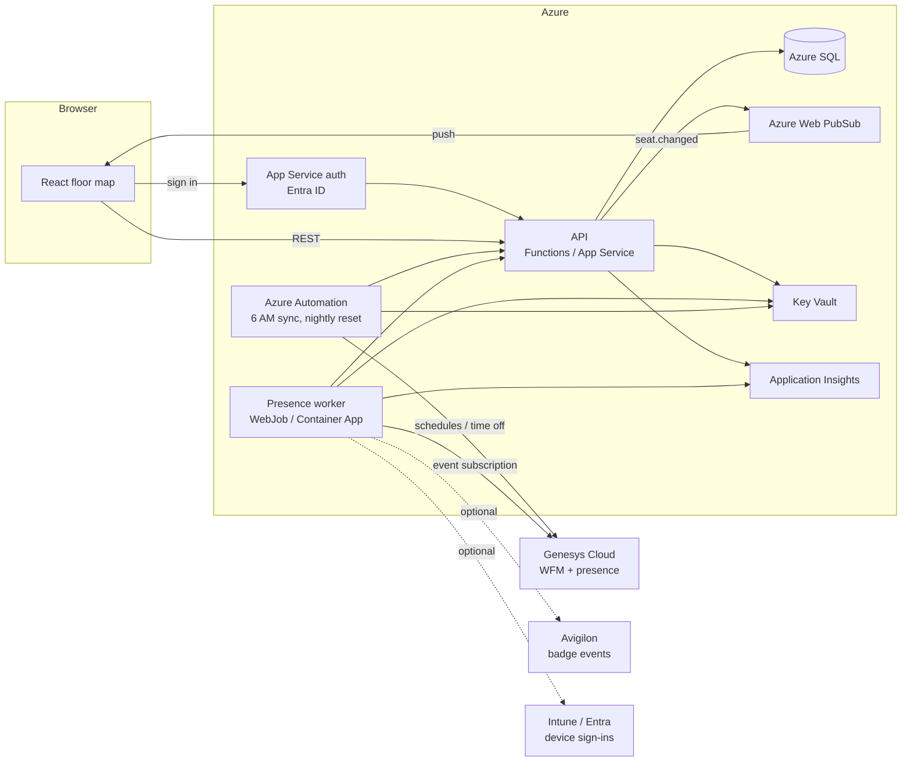

# Architecture

## Components

Every write — supervisor claims, runbook updates, worker events — goes through
the API, so permissions, block rules, concurrency and the Web PubSub broadcast
live in one place. Automation authenticates to the API with a managed identity
and an app role (`Seating.Automation`).

## Request flows

**Claim a seat**
1. Supervisor selects an Open seat, enters the agent, clicks Claim.
2. `POST /api/days/{date}/seats/{seatId}/claim` with the row version the client last saw.
3. API runs a single conditional `UPDATE` (status `Open`, row version matches). Zero rows updated → `409` with the current claimant.
4. API writes a `SeatEvent`, commits, then publishes `seat.changed` to the `day:{date}` group.
5. Every connected client patches the seat.

**Morning sync**
1. Runbook (PowerShell 7) gets a Genesys OAuth token from Key Vault secrets.
2. Pulls today's agent schedules and approved time off for the management units that sit on Metro.
3. Maps Genesys user → home seat (from SQL), and posts a batch of status changes to the API: not scheduled → `Open` (source `WFM`).
4. API applies them and broadcasts once per batch.

**No-show detection**
1. Worker holds a Genesys notification channel subscribed to presence / routing status for Metro agents.
2. At shift start + grace (default 15 min) with no login and, if enabled, no badge-in → `LikelyOpen` (source `Presence`).
3. Supervisor confirms → `Open`, or dismisses → stays `Assigned`.
4. Agent goes offline after scheduled end or for the rest of a split → `Open` for the remaining hours.

## Real-time contract

- Group per work date: `day:2026-10-28`. Clients join today's group plus whichever day they are viewing.
- Message: `{ "type": "seat.changed", "date": "...", "seatId": "A14", "status": "Claimed", "rowVersion": "...", "claimedFor": "...", "claimedBy": "..." }`.
- Push is a hint, not the source of truth. On connect, reconnect or a gap, the client refetches `GET /api/days/{date}`.

## Security

- Enterprise app: assignment required; group `Metro Supervisors` → `Seating.Supervisor`; small admin group → `Seating.Admin`; viewer group or TV account → `Seating.Viewer`.
- Conditional Access applies as for any Entra app. Optionally restrict to office network.
- Managed identities for API → SQL, API → Web PubSub, everything → Key Vault.
- Genesys OAuth client: client-credentials grant, least scopes needed for WFM schedules and user presence.

## Environments

`dev` (can share the Free Web PubSub tier and Basic SQL) and `prod`. Genesys has a dev org; point `dev` at it.
